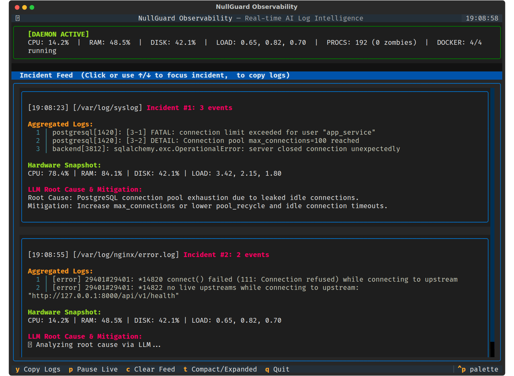

# NullGuard

> **Developed and maintained by [Nullfunc s.r.o.](https://nullfunc.com)**

**NullGuard** is a high-performance, hybrid C++/Python server observability and log intelligence platform. It combines a fast C++ streaming core with a Python orchestrator to deliver real-time system metrics, smart incident detection, AI-powered root cause analysis, and multi-channel alerting — all inside a reactive terminal dashboard.

<p align="center">
  
</p>

---

## 🌟 Feature Overview

| Feature                      | Description                                                                                                                                                         |
| ---------------------------- | ------------------------------------------------------------------------------------------------------------------------------------------------------------------- |
| **High-Speed Log Streaming** | C++ backend filters logs with `std::regex` (case-insensitive via `icase`) for near-zero overhead I/O.                                                               |
| **Smart Incident Windows**   | 3-second sliding windows aggregate and deduplicate burst errors into a single incident (SHA256 hashing strips ephemeral data like timestamps and memory addresses). |
| **Instant UI Feedback**      | Incident cards appear immediately with a `⏳ Analyzing...` placeholder. The AI result updates the card in-place when the LLM responds.                               |
| **AI Root Cause Analysis**   | LiteLLM integration (OpenAI, Claude, Gemini, OpenRouter, etc.) generates concise RCA and mitigation advice per incident.                                            |
| **Universal Alerting**       | Apprise integration dispatches incident and debounced system health alerts to Telegram, Discord, Slack, and 80+ other services simultaneously in clean DevOps Markdown.              |
| **Reactive Textual TUI**     | Modern terminal dashboard with sticky OS metrics, smooth scrolling (`[↑]`/`[↓]`, `[PgUp]`/`[PgDn]`, `[J]`/`[K]`, mouse wheel), line numbering, and `[Y]` copy.      |
| **OS & Hardware Metrics**    | CPU, RAM, Disk, Swap, Load Average (1/5/15m), Total Processes, Zombie Processes — read natively from `/proc`.                                                       |
| **Docker Awareness**         | Queries `/var/run/docker.sock` to show running vs. total container counts.                                                                                          |
| **State Persistence**        | SQLite (WAL mode) safely synchronizes state across the daemon and UI, ensuring no duplicate alerts across restarts.                                               |
| **Global CLI & Daemon**      | Typer-powered interface (`nullguard`) with `fcntl`-locked background daemon management.                                                                             |

---

## 🛠️ Architecture

```
                      ┌─────────────────────────┐
                      │   nullguard (Typer CLI) │
                      │  start | stop | ui | ...│
                      └────────────┬────────────┘
                                   │
              ┌────────────────────┴────────────────────┐
              ▼                                         ▼
┌───────────────────────────────┐         ┌───────────────────────────────┐
│     Background Daemon         │         │         Reactive TUI          │
│    (nullguard/daemon.py)      │         │      (nullguard/tui.py)       │
│                               │         │                               │
│  ┌─────────────────────────┐  │         │  ┌─────────────────────────┐  │
│  │   fcntl.flock PID Lock  │  │         │  │ Sticky OS Metrics Panel │  │
│  └─────────────────────────┘  │         │  └─────────────────────────┘  │
│  ┌─────────────────────────┐  │         │  ┌─────────────────────────┐  │
│  │ IncidentWindow (3s agg) │  │         │  │ Scrollable ListView     │  │
│  └─────────────┬───────────┘  │         │  │ - Focusable Incidents   │  │
│                │              │         │  │ - Line Numbering        │  │
│         process_incident()    │         │  │ - [Y] Clipboard Copy    │  │
│         LiteLLM RCA / Apprise │         │  └─────────────────────────┘  │
└────────────────┬──────────────┘         └───────────────▲───────────────┘
                 │                                        │
                 ▼                                        │
      ┌───────────────────────────────────────────────────┴─┐
      │         SQLite Database (WAL Mode)                  │
      │  - metrics snapshot    - log read offsets           │
      │  - incident records    - deduplication cache        │
      └───────────────────────────▲─────────────────────────┘
                                  │
      ┌───────────────────────────┴─────────────────────────┐
      │          nullguard_core (C++20 / Pybind11)          │
      │  ┌─────────────────────────┐ ┌───────────────────┐  │
      │  │ LogWatcher (std::regex) │ │ SystemMonitor     │  │
      │  │ (near-zero overhead I/O)│ │ (/proc & sysinfo) │  │
      │  └─────────────────────────┘ └───────────────────┘  │
      └─────────────────────────────────────────────────────┘
```

---

## 🚀 Installation & Build

### Prerequisites

- Python 3.12+ (with `python3-venv` and development headers `python3-dev`)
- CMake 3.14+
- GCC / Clang (`g++` with C++20 support)
- `git` and `curl` (for CMake dependency fetching and pip bootstrapping)

### Option A: Fully Automated Native Install (Recommended)

Our self-healing automated script validates all prerequisites in a single pass, creates a fast isolated environment in `~/.nullguard` (bootstrapped directly via `get-pip.py`), builds the C++ module, installs dependencies, and creates a global `nullguard` command (in `/usr/local/bin` when running as root/sudo, or `~/.local/bin` for unprivileged users).

```bash
# 1. Clone the repository
git clone https://github.com/Nullfunc-s-r-o/nullguard.git
cd nullguard

# 2. Run the automated installer
./install.sh

# 3. You can now run the tool from anywhere!
nullguard start
```

### Option B: Docker (Host Monitoring Mode)

The Docker deployment tracks your host machine's hardware and container metrics identically to a native install.

```bash
# 1. Provide an initial configuration
cp config.example.yaml config.yaml
# Edit config.yaml to add your Apprise URLs and logs

# 2. Set your LLM API key (e.g. OpenRouter)
export OPENROUTER_API_KEY="sk-or-v1-..."

# 3. Build and deploy
docker-compose up -d --build
```

The `docker-compose.yml` mounts `/proc`, `/sys`, `/var/log`, and `/var/run/docker.sock` with `pid: "host"` so NullGuard inspects the **host machine**, not just the container.

---

## ⌨️ CLI Commands

NullGuard is managed globally via the `nullguard` command:

| Command            | Description                                                                |
| ------------------ | -------------------------------------------------------------------------- |
| `nullguard start`  | Starts the monitoring daemon invisibly in the background.                  |
| `nullguard stop`   | Gracefully shuts down the background daemon.                               |
| `nullguard ui`     | Opens the live Textual TUI dashboard (safely reads from SQLite WAL).       |
| `nullguard config` | Opens `config.yaml` securely in your `$EDITOR` (or triggers setup wizard). |
| `nullguard status` | Shows daemon up-time, lockfiles, and the latest hardware metrics snapshot. |

---

## 🖥️ TUI Navigation & Hotkeys

Inside the Textual TUI (`nullguard ui`):

| Key | Action |
|---|---|
| `Y` | **Yank / Copy** — Copies the raw log trace of the currently focused incident to the system clipboard. |
| `P` | **Pause / Resume** — Freezes the live incident feed display. |
| `C` | **Clear** — Clears the displayed incident feed. |
| `T` | **Toggle Layout** — Switches between Expanded (full incident cards) and Compact (one-line summaries). |
| `J` / `↓` | **Next Incident** — Moves focus down to the next incident. |
| `K` / `↑` | **Previous Incident** — Moves focus up to the previous incident. |
| `PgUp` / `PgDn` | **Page Scroll** — Scrolls up or down rapidly through the incident feed. |
| **Mouse Wheel / Click** | **Mouse Control** — Click any incident card to focus it; scroll with mouse wheel smoothly. |
| `Q` / `Ctrl+C` | **Quit** — Exits the TUI dashboard without stopping the background monitoring daemon. |

---

## ⚙️ Configuration (`config.yaml`)

Your configuration and database are stored safely in `~/.nullguard/`. If no config is found when you run `nullguard start`, the **First-Run Wizard** launches automatically.

You can also edit `~/.nullguard/config.yaml` manually via `nullguard config`:

```yaml
ai_analysis:
  enabled: true
  # Any LiteLLM-compatible model string.
  # Prefix with 'openrouter/' to use OpenRouter:
  model: "openrouter/anthropic/claude-3-haiku"

alerting:
  enabled: true
  # Add as many Apprise-compatible URLs as you want.
  # All URLs receive every incident alert simultaneously.
  urls:
    - "tgram://<BOT_TOKEN>/<CHAT_ID>"
    - "discord://<WEBHOOK_ID>/<WEBHOOK_TOKEN>"
    - "slack://<TOKEN>/<CHANNEL>"

logs:
  # Use 'preset: default' for the smart universal regex.
  - path: "/var/log/syslog"
    preset: "default"

health_alerts:
  cooldown_seconds: 300
  sustained_cycles: 3       # Debounce: alert only if metric breaches threshold for N consecutive polls
  sustained_seconds: 0      # Optional: require breach to persist for N seconds (e.g. 120)
  min_load_5m: 1.0          # Optional: require 5m load average >= threshold for CPU alerts
  thresholds:
    cpu: 85.0
    ram: 90.0
    disk: 95.0
    swap: 80.0
    load: 4.0
    load_5m: 3.5
```

### System Health Alert Debouncing

To eliminate false alarms caused by transient single-second spikes (such as a cron job or compiler burst), NullGuard includes an alert debouncing engine:
- **`sustained_cycles`**: Requires the metric to continuously breach the configured threshold for $N$ consecutive polling cycles (default: `3`) before triggering an alert.
- **`sustained_seconds`**: Optional time window in seconds that the breach must persist.
- **`min_load_5m`**: Optional 5-minute load average gate for CPU alerts to distinguish momentary single-thread bursts from true multi-core system exhaustion.
- **Automatic Reset**: If the metric drops back below the threshold before the sustained criteria are met, the debounce counter and duration timer are instantly reset.

### LLM API Keys

NullGuard reads API keys from environment variables. Set whichever key matches your provider:

```bash
export OPENROUTER_API_KEY="sk-or-v1-..."
export OPENAI_API_KEY="sk-..."
export ANTHROPIC_API_KEY="sk-ant-..."
export GEMINI_API_KEY="..."
```

---

## 🐳 Monitoring Docker Container Logs

There are two ways to watch logs inside running containers:

### Method 1 — Shared Volume (Recommended)

In your target container's `docker-compose.yml`, expose its log directory to the host:

```yaml
# nginx/docker-compose.yml
volumes:
  - /opt/nginx_logs:/var/log/nginx
```

Then point NullGuard at the host path:

```yaml
# ~/.nullguard/config.yaml
logs:
  - path: "/opt/nginx_logs/error.log"
    preset: "default"
```

### Method 2 — Docker JSON Logs (Global)

Docker writes all container stdout/stderr to JSON files on the host:

```yaml
logs:
  - path: "/var/lib/docker/containers/<container-id>/<container-id>-json.log"
    preset: "default"
```

---

## 🔒 Security Notes

- Never commit real API keys or Apprise tokens to `config.yaml`. Use environment variables for LLM keys.
- The `docker-compose.yml` mounts the Docker socket **read-only** (`ro`).
- `config.yaml` is git-ignored by default to prevent accidental secret leakage.

---

## 🏢 About Nullfunc

**[Nullfunc s.r.o.](https://nullfunc.com)** is an advanced IT software company based in Prague, Czech Republic. We specialize in building cutting-edge system architecture, high-performance tooling, and B2B AI automation platforms like **[NullexLab](https://nullexlab.com)** alongside observability tooling like **NullGuard**. 

[LinkedIn](https://www.linkedin.com/company/nullfunc) | [GitHub](https://github.com/Nullfunc-s-r-o)

---

## 📄 License

NullGuard is officially developed and maintained by **Nullfunc s.r.o.** and is licensed under the strict **GNU Affero General Public License v3.0 (AGPLv3)**.

You are free to use, modify, and distribute this software under the terms of the AGPLv3. However, if you modify the software and make it available over a network, you must also make your modified source code available to your users. 

**Dual-Licensing for Commercial Needs:**
If the AGPLv3 license does not fit your commercial requirements (e.g., you wish to embed NullGuard into a proprietary, closed-source product), please contact Nullfunc s.r.o. directly to inquire about a commercial dual-license.

---

## 📦 Dependencies

| Package   | Purpose                                                               |
| --------- | --------------------------------------------------------------------- |
| `typer`   | Clean, robust CLI framework                                           |
| `textual` | Advanced reactive TUI framework with widgets and native mouse support |
| `pyperclip` | System clipboard integration for non-blocking incident text copying (`[Y]`) |
| `rich`    | Terminal formatting and console prompts for CLI commands              |
| `litellm` | Universal LLM gateway (OpenAI, Claude, Gemini, OpenRouter…)           |
| `docker`  | Docker socket SDK for container count metrics                         |
| `apprise` | Universal notification gateway (Telegram, Discord, Slack, 80+ others) |
| `PyYAML`  | Configuration file parsing                                            |
